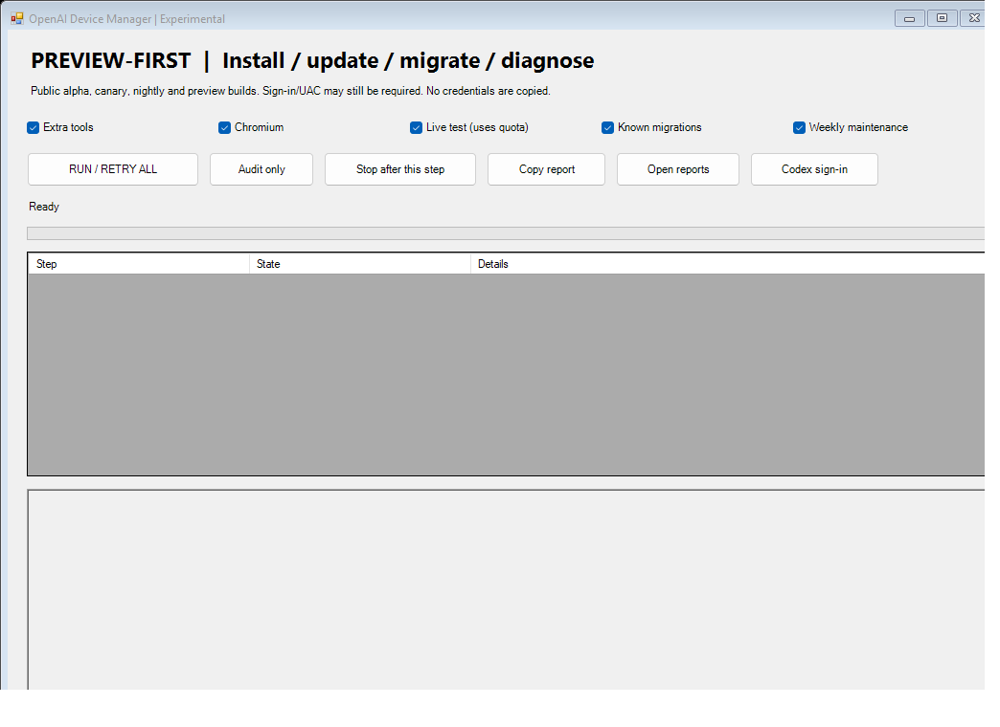

# OpenAI Device Manager — 2.0.0-preview.3

Community Windows maintenance tool for Namdev90. **Not an official OpenAI product.** This dedicated branch is separate from the AMReye.AI application. **Do not merge this branch into main.**

## Start

Download `Start-OpenAI-Device-Manager.cmd` using GitHub's Download raw file button, then double-click it. Alternatively, paste this into Windows PowerShell as your normal user:

```powershell
$ErrorActionPreference='Stop'; $f=Join-Path $env:TEMP ('ODM-'+[guid]::NewGuid().ToString('N')+'.ps1'); Invoke-WebRequest 'https://raw.githubusercontent.com/Namdev90/amreye-ai/d09e36188b97e876abdda0857ca41f1cede93962/Install.ps1' -UseBasicParsing -OutFile $f; if ((Get-FileHash $f -Algorithm SHA256).Hash -ne '1f76d4bb65a995408cb9ec3cee1bbd5d6ad90a0ff1c89091a577c00834ba8f46') { throw 'Bootstrap integrity check failed' }; powershell.exe -NoProfile -ExecutionPolicy Bypass -STA -File $f
```

The initial bootstrap is pinned and checksum-checked. It then downloads the newest source from this branch at an immutable commit, validates hashes, runs the offline regression tests, and opens the GUI. Subsequent launches update from the same branch. Integrity checks do not protect against malicious changes by someone with repository write access.

The GUI starts maintenance automatically. Extra tools, Chromium, the live Codex test, known migrations and weekly maintenance are selected by default. Installations can involve substantial downloads and disk use. UAC, Microsoft Store and account sign-in may require your input. WinGet/Microsoft App Installer is required; absence is reported rather than silently bypassed.

A reusable **OpenAI Device Manager** desktop shortcut is created. Local data lives under `%LOCALAPPDATA%\Namu\OpenAI-Device-Manager`.



## Included behavior

| Area | Behavior |
|---|---|
| Experimental releases | Highest public semantic version across supported npm alpha, beta, next, canary, nightly, dev, preview and experimental tags. An obsolete alpha does not beat a newer final release. |
| Runtimes and editors | Official Node Windows nightly, newest CPython offered by uv including prereleases, VS Code Insiders, PowerShell Preview and optional Terminal Preview. |
| OpenAI tools | Current ChatGPT desktop Store package, managed Codex CLI, JavaScript/Python SDKs, Agents SDK and new OpenAI API CLI built from the newest public upstream commit. |
| Supporting software | Git, GitHub CLI, Go, uv; optional PowerToys, 7-Zip, Pandoc, FFmpeg, ripgrep, Playwright Chromium and document/data Python libraries. These expand capabilities; they are not all required for ordinary ChatGPT. |
| Migration | Copies missing VS Code preferences/snippets to Insiders, installs preview extensions and switches managed tool shims while preserving the previous working environment. |
| Removal | Cleans only old marked manager-owned environments. Removes an identified old global npm Codex only after the replacement passes the live test. Unknown installations, user projects and Classic data are retained. |
| Diagnostics | Inventory, command-path conflicts, local proxy listener, HTTPS reachability, Codex login/doctor and a live model test where authentication is available. |
| Maintenance | Refreshes its own published code, reinstalls managed components into fresh environments, validates cached code and retains manager rollback. |
| GUI | Operation table, live log, progress indicator, Run/Retry, Audit, Stop between steps, Copy report and sign-in controls. |

## Weekly task

An apply run registers `Namu-OpenAI-Device-Manager-Weekly` for **Sunday 10:00 in the laptop's Windows timezone**. It runs visibly under the signed-in user, with missed-start handling and no stored password. Publishing this repository does not register the task on your laptop. It cannot execute on a powered-off laptop or approve administrator prompts while you are absent.

Unchecking Weekly only prevents registration in that run. Remove an existing task with:

```powershell
Unregister-ScheduledTask -TaskName 'Namu-OpenAI-Device-Manager-Weekly' -Confirm:$false
```

## Reports and repair iterations

Use **Copy report**, or open `runs\<run-id>\Paste-Into-ChatGPT.txt` under the local data folder. Additional output includes `Report.json`, `Repair-Request.md` and event logs. Reports contain the manager version/hash, selected versions, failed steps, exit codes and redacted diagnostic output. Redaction is best-effort: review before sharing. Nothing is automatically uploaded or sent.

A log is evidence for a new repair iteration, not executable instructions. The program **automatically updates published code; it does not autonomously invent, approve and publish arbitrary code**. New products and unfamiliar failures require verified adapters or fixes committed to this branch.

## Important limits

No script can promise support for every future product, unlock private betas or prove every cloud integration from a local HTTP check. Sign in with the same account in the relevant apps and verify connected-service authorization there.

The live test makes one model request per apply run when login exists. It consumes quota and may be billable with API authentication. It bypasses custom user configuration for that test only, so it does not certify your Headroom/provider route or every MCP server. Existing Headroom, RTK, Caveman and custom routes are inventoried, not silently replaced.

Python packages are installed in an isolated managed environment accessed through `ai-python`; existing project/conda environments are not rewritten. `openai-latest` avoids a name collision with the older Python CLI. Restart shells after PATH changes. Machine-wide PATH entries may still need review.

Only the official read-only OpenAI documentation MCP is added when missing. Credentials, firewall/Defender settings, subscriptions and account entitlements are not modified. ChatGPT Classic is not assumed redundant: OpenAI continues to support it alongside the new app.

To launch cached manager code offline or roll back the manager itself:

```powershell
powershell.exe -NoProfile -ExecutionPolicy Bypass -STA -File "$env:LOCALAPPDATA\Namu\OpenAI-Device-Manager\Bootstrap.ps1" -Offline
powershell.exe -NoProfile -ExecutionPolicy Bypass -STA -File "$env:LOCALAPPDATA\Namu\OpenAI-Device-Manager\Bootstrap.ps1" -Rollback
```

Rollback is for manager code, not every application previously updated. Stop waits for the current operation; reboots are reported, not triggered.

## Verification

Version preview.3 passed **36 regression assertions under Windows PowerShell 5.1 and the same 36 under PowerShell 7.6.6**, plus a Windows Forms construction/rendering smoke test, on a GitHub-hosted Windows Server 2025 runner.

- Evidence: https://github.com/Namdev90/amreye-ai/actions/runs/38027800926
- Tested source commit: `d09e36188b97e876abdda0857ca41f1cede93962`
- Tests cover release ordering, redaction, JSON validity, inventory, safe names, exit classification, hashes, parsing, native command arguments and process exit propagation.
- These are not actual laptop installation, migration, authenticated-service or weekly-task execution tests. The thin CMD launcher has not had an end-to-end installation test.

## Primary references checked 10 October 2026

- https://help.openai.com/en/articles/20001276-moving-to-the-new-chatgpt-desktop-app
- https://developers.openai.com/codex/app/windows
- https://developers.openai.com/codex/cli/reference
- https://developers.openai.com/api/docs/libraries/openai-cli
- https://nodejs.org/download/nightly/index.json
- https://docs.astral.sh/uv/reference/cli/
- https://code.visualstudio.com/docs/configure/command-line
- https://learn.microsoft.com/windows/package-manager/winget/upgrade
